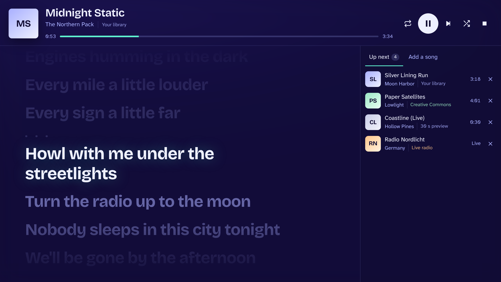

# 🐺 WolfRadio

A self-hosted Discord music bot built for a community server.
Type a song, **pick the right result from a menu**, and it plays in your server's music channel.

Built with **TypeScript**, **discord.js v14** and **Lavalink v4**, designed to run 24/7 on a Raspberry Pi 5 with Docker.
Version 2 adds a **Discord Activity**: a web app that opens inside the voice channel, built with React and the Embedded App SDK.



## Features

- 🖥️ **Activity (V2)** — open WolfRadio inside the voice channel: karaoke-style synced lyrics, cover art, progress, the shared queue, controls and search, with the same DJ rules as the commands

- 🔎 **Search & pick** — `/play` shows up to 25 results in a select menu; nothing plays until you choose
- 🎯 **One music channel** — each server picks the voice channel WolfRadio plays in with `/setup channel`; the Now Playing card lives in that channel's chat
- 📀 **Your own library** — full tracks from your [Navidrome](https://www.navidrome.org/) server, matched by ISRC or title
- 🔀 **Library shuffle** — `/random` plays random songs (filter by genre or years), or keeps going forever with `endless`
- 🌿 **Creative Commons music** — full tracks from [Jamendo](https://www.jamendo.com), with license attribution
- ⏱️ **Official previews** — 30-second previews from the Deezer catalog when no full version is available
- 📻 **World radio** — tens of thousands of stations from [radio-browser.info](https://www.radio-browser.info), by name, country or genre, plus server favorites
- 🎤 **Synced lyrics** — time-synced lines from [LRCLIB](https://lrclib.net) in the Now Playing card (optionally in the voice channel status)
- 🏷️ **Voice channel status** — the current song under the voice channel name; the bot profile shows *Listening to …*
- 🎧 **Spotify listening party** — everyone hears the same song at the same time on their **own** Spotify app
- 🛡️ **DJ system** — DJ role, vote-skip for everyone else, per-user queue limits and cooldowns
- 🔊 **Channel rules** — restrict music to specific voice channels (e.g. a private listening room)
- 📝 **Song-request channel** — type a title in a dedicated channel to get the picker
- 🎛️ **Filters** — bass boost, nightcore, vaporwave, 8D, karaoke, low pass, EQ presets
- 🌙 **24/7 mode** and automatic leave when the channel is empty
- 🧹 **Tidy chat** — the bot deletes its own messages after 3 minutes (configurable)
- 🕹️ **Now Playing card** with pause, skip, stop, loop and shuffle buttons

## How sources work

Big music bots read metadata from one service and fetch audio from another. WolfRadio uses the same idea, but every audio source is one it's allowed to use:

```
/play "song title"
   │
   ├─ Navidrome search ──────────► 📀 your library (full track)
   └─ Deezer catalog search ─────► pick a result ─┬─► in your library?  → 📀 full track
                                                  ├─► Jamendo CC match? → 🌿 full track
                                                  └─► otherwise         → ⏱️ 30 s preview
```

Lavalink only has the `http` source enabled: no YouTube, SoundCloud or other platform scraping, and no DRM circumvention.

The **Spotify listening party** works differently: WolfRadio never touches Spotify audio. It keeps a shared queue and a
clock, and uses the Spotify Web API to start the same track at the same position on each member's own Spotify app.

> **Note on rights.** Jamendo tracks and Deezer previews are fine to play with attribution (shown in the Now Playing card).
> Playing **your own library** or **web radio** to other people is a public performance that normally needs a license
> (in Italy: SIAE + SCF). Both modules are **off by default** — enable them knowingly, for private use or small private servers.
> Lyrics come from LRCLIB, a community database; lyrics are copyrighted text too, so the feature is also off by default.

## Commands

| Command | Description |
| --- | --- |
| `/play query [source]` | Search and pick a song. Accepts Deezer track links too |
| `/random [count] [genre] [from_year] [to_year] [endless]` | Random songs from your library; `endless` (DJ) keeps adding until `/stop` |
| `/radio search [name] [country] [genre]` | Find a station (country: name or 2-letter code) |
| `/radio random [genre] [country]` · `/radio favorites` | Random station · server favorites |
| `/radio save` · `/radio unsave` | Manage favorites (DJ) |
| `/queue` · `/nowplaying` | Show the queue · current song |
| `/skip` | Skip (DJs and the requester skip instantly, others vote) |
| `/pause` · `/stop` · `/leave` · `/clear` | Playback control (DJ) |
| `/loop` · `/shuffle` · `/volume` · `/filter` | Playback options (DJ) |
| `/remove position` | Remove a song (your own, or any as DJ) |
| `/party link` · `/party unlink` | Connect / disconnect your Spotify account |
| `/party start` · `/party add` · `/party join` · `/party leave` · `/party sync` · `/party queue` | Listening party |
| `/party pause` · `/party skip` · `/party end` | Party control (host or DJ) |
| `/setup channel` | **Choose the voice channel WolfRadio plays in** (Manage Server) |
| `/setup show · djrole · requests · stay247` | Server settings (Manage Server) |
| `/help` | Command overview |

**Who is a DJ?** Members with *Manage Server*, members with the DJ role, everyone when no DJ role is set, and anyone alone with the bot.

## Setup

### 1. Discord application

1. Create an application at the [Discord Developer Portal](https://discord.com/developers/applications) and add a bot.
2. Copy the **bot token** and the **application ID**.
3. Only if you use the request channel: enable **Message Content Intent**.
4. Invite the bot with the `bot` and `applications.commands` scopes and these permissions:
   View Channels, Send Messages, Embed Links, Read Message History, Connect, Speak, **Set Voice Channel Status**.

### 2. Configuration

```bash
cp .env.example .env
```

Fill in `DISCORD_TOKEN`, `CLIENT_ID`, a strong `LAVALINK_PASSWORD`, and turn on what you want:

| Feature | Variables |
| --- | --- |
| Deezer previews | `ENABLE_PREVIEWS=true` (no key) |
| Jamendo | `ENABLE_JAMENDO=true`, `JAMENDO_CLIENT_ID` from the [Jamendo dev portal](https://devportal.jamendo.com) |
| Library | `ENABLE_LIBRARY=true`, `NAVIDROME_URL`, `NAVIDROME_USER`, `NAVIDROME_PASSWORD`, `MUSIC_DIR`, `COMPOSE_PROFILES=library` |
| Radio | `ENABLE_RADIO=true` |
| Lyrics | `ENABLE_LYRICS=true` (optional `LYRICS_OFFSET_MS`, `LYRICS_IN_VOICE_STATUS`) |
| Voice channel status | `VOICE_CHANNEL_STATUS=true` (default) |
| Spotify party | see below |

> After turning a feature on or off, run `docker compose up -d` **and** register the commands again —
> the slash-command options depend on what's enabled.

### 3. Run with Docker (recommended, works on Raspberry Pi 5)

```bash
docker compose up -d --build
docker compose run --rm wolfradio node dist/deploy-commands.js   # register slash commands
```

Then, in Discord, choose the music channel: `/setup channel channel:#your-voice-channel`.
WolfRadio also posts a reminder when it joins a new server.

With your music library: set `MUSIC_DIR` and `COMPOSE_PROFILES=library` in `.env`, run `docker compose up -d`,
open Navidrome on port `4533`, create the admin user and use the same credentials in `.env`.

### Spotify listening party

1. Create an app in the [Spotify Developer Dashboard](https://developer.spotify.com/dashboard), select **Web API**,
   and add the redirect URI `http://127.0.0.1:8888/callback`.
2. Copy **Client ID** and **Client secret** into `.env`, set `ENABLE_SPOTIFY_PARTY=true` and a random `TOKEN_ENCRYPTION_KEY` (32+ characters).
3. In **User Management**, add each listener's name and Spotify e-mail.
4. `docker compose up -d`, then register the commands again.

Each listener runs `/party link` once. On the bot's computer the browser comes back to WolfRadio directly;
everyone else lands on a page that doesn't load — they copy its address and press **Paste address** in Discord.

**Spotify limits (Development mode, since 2026):** the app owner needs Spotify Premium, an app can have at most
**5 users**, and controlling playback needs Premium for each listener. Members without Premium can still follow along
with the **Open in Spotify** button. Tokens are stored encrypted (AES-256-GCM) in `data/spotify-tokens.json`;
`/party unlink` deletes them.

### WolfRadio V2: the Activity

The Activity is served by the bot itself (web app + API + WebSocket on `ACTIVITY_PORT`). Discord loads it through its
own proxy, so the bot needs a public HTTPS address: the `tunnel` service (Cloudflare quick tunnel) provides one.

1. In the [Developer Portal](https://discord.com/developers/applications), open the WolfRadio application:
   - **OAuth2** → copy the **Client Secret** into `DISCORD_CLIENT_SECRET`, and add the redirect `https://127.0.0.1` (a placeholder the Activity flow requires).
   - **Installation** → *Installation Contexts*: tick **Guild Install** and **User Install** (the *Install Link* can stay *None*).
   - **Activities → Settings** → **Enable Activities**. This creates the *Launch* entry point command.
2. In `.env`: `ENABLE_ACTIVITY=true`, and add `activity` to the profiles, e.g. `COMPOSE_PROFILES=library,activity`.
3. `docker compose up -d --build`, then find the public address:
   ```bash
   docker compose logs tunnel | grep trycloudflare.com
   ```
4. **Activities → URL Mappings**: prefix `/`, target the address **without** `https://` (e.g. `quiet-wolf-moon.trycloudflare.com`).
5. In Discord, join the music channel → **Activities** (rocket icon) → **WolfRadio**.

A quick tunnel gets a new address every time it restarts, so step 4 must be repeated then.
For a permanent address, use a [named Cloudflare Tunnel](https://developers.cloudflare.com/cloudflare-one/connections/connect-networks/) with your own domain.

How it's put together:

```
Discord client ── iframe ──► {app}.discordsays.com (Discord proxy) ──► tunnel ──► bot :8080
                                                                           ├── /            React app (Vite build)
                                                                           ├── /api/token   OAuth code → token + signed session
                                                                           ├── /api/art     signed artwork proxy (no open proxy, no LAN)
                                                                           └── /api/ws      live state + controls (same rules as slash commands)
```

To work on the UI: `npm run dev:activity` (Vite on port 5173, proxying `/api` to the bot), and open
`http://localhost:5173/?demo` to see it with sample data outside Discord.

### Run locally for development

Requires Node.js 22.12+ and a running Lavalink v4.

```bash
npm install
npm run build && npm run deploy   # set DEV_GUILD_ID for instant command updates
npm run dev
```

## Project structure

```
src/
├── index.ts               # startup, welcome message, shutdown
├── activity/              # V2: web server, OAuth, sessions, art proxy, WebSocket, shared protocol
├── deploy-commands.ts     # registers slash commands
├── config.ts · store.ts   # env config · per-server settings (data/guilds.json)
├── commands/              # slash commands (/play, /radio, /party, …)
├── interactions/          # router, select menus, request channel
├── music/                 # Lavalink, queueing, controls, autoplay, lyrics, voice status, embeds
├── sources/               # Deezer, Navidrome, Jamendo, radio-browser, LRCLIB, resolver
└── spotify/               # OAuth, encrypted token store, Web API client, party engine
activity/                  # V2 web app: React + Vite + Embedded App SDK
lavalink/application.yml   # Lavalink config (http source only)
```

## Roadmap

- Web player / dashboard
- `/recap` listening stats
- Spotify and Apple Music links as metadata input

## License

[MIT](LICENSE)
